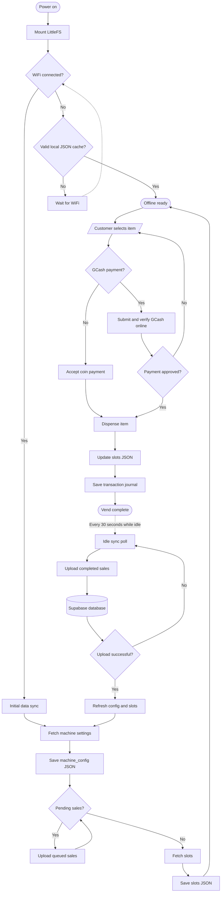

# 4Peace ESP32 Offline-First Workflow

## Rules represented by the flow

- A first boot cannot vend until `machine_config.json` and `slots.json` have
  both been downloaded and saved to LittleFS.
- A later reboot may operate without WiFi when both JSON cache files are valid.
- GCash reference submission and payment approval require an internet connection.
- After payment approval, physical dispensing and stock reduction use local
  LittleFS data first.
- Each completed sale is placed in the durable transaction journal. The ESP32
  uploads it to Supabase only during the idle 30-second sync cycle.
